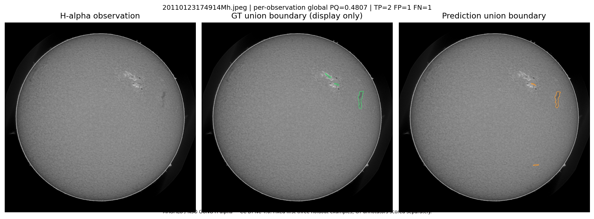

# Solar filament instance segmentation

Native training, held-out evaluation and inference on all 180 test observations
are complete. Kaggle accepted the prediction CSV, which is selected for final
evaluation. The report and reproducible model artifacts are included; the final
entry form remains pending.

The model is an original **487,857-parameter U-Net**, trained from scratch for
24 epochs on 558 observations in the native Kaggle GPU environment with
Internet off. It uses image intensity and local contrast, without pretrained
weights or external datasets. Eight observations were reserved for development
and 141 for a separate holdout. All annotation sets for one observation stay
together. Training unions foreground masks; evaluation scores annotators
separately. Filenames group inputs, while dates, URLs, categories and spines
are excluded from predictor features.

## Actual local results

| Split | Observations | Pooled instance PQ |
| --- | ---: | ---: |
| Development | 8 | 0.377220 |
| Holdout | 141 | **0.318382** |

Threshold **0.65** was selected from the predefined 0.45 / 0.65 / 0.80 options
using only development data and frozen before holdout/test inference. The
holdout has 255 annotator-image comparisons: TP 952, FP 1,200, FN 712. Its
exploratory 95% observation-cluster bootstrap interval is **[0.300871, 0.335262]**
(1,000 resamples, seed 2026). Filename-based splitting does not establish
temporal independence or guaranteed interval coverage.

These are local results using the organizer's v6 strict IoU > 0.5 all-hit PQ,
with globally pooled counts; they are not a Kaggle leaderboard score. See
[`outputs/holdout-results.json`](outputs/holdout-results.json) and
[`outputs/threshold-freeze.json`](outputs/threshold-freeze.json).

The actual [`outputs/submission.csv`](outputs/submission.csv) contains 1,661
unique instance rows for 178 images; two zero-detection images receive no
fabricated rows and are recorded in the coverage manifest. All 180 test images
were processed, and all 1,661 written compressed COCO RLE masks were reread,
decoded and compared with their inferred-mask hashes in the native run. The
CSV is 390,234 bytes, SHA-256
`06253901c0c3428a22c1b67bc47515c1f38551cd54ae11d829689bdf5d453574`.
Kaggle reports Success / Complete and displays a public score of **0.28**
(displayed precision only). This CSV is selected for final evaluation.

## Reproduce inference without retraining

The actual `model/weights.pt`, `model/config.json` and
`model/training-manifest.json` are included. Run from this repository's root,
replacing `/path/to/competition-data` with the official root containing
`train/` and `test/`. Use a separate output directory to preserve the recorded
native results:

```sh
python run_pipeline.py --data-root /path/to/competition-data --model-dir model --output-dir reproduced-outputs --development-report outputs/development-results.json --device cpu --no-display
```

This reuses the completed development receipt and does not train. A compatible
GPU can use `--device cuda`. The complete self-contained, 20-cell
[`solar_complete_pipeline.ipynb`](solar_complete_pipeline.ipynb) also defaults
to model resume. The source notebook contains no fabricated execution outputs;
the actual completed run is documented by the included native artifacts.

`requirements.txt` pins all 13 distribution versions captured by
[`outputs/runtime-manifest.json`](outputs/runtime-manifest.json), including
actual OpenCV distribution builds, joblib, Matplotlib and IPython. Python is
3.13.16, PyTorch is 2.11.0+cu130 and the native CUDA build is 13.0. This records
the captured package subset rather than a full transitive pip freeze.
CUDA-tagged wheels require a matching runtime/package source. Fixed seeds do
not promise cross-platform GPU bitwise identity.

For explicit from-scratch reproduction in a compatible GPU environment, use
separate model/output locations:

```sh
python run_pipeline.py --data-root /path/to/competition-data --model-dir retrained-model --output-dir retrained-outputs --train --checkpoint-dir retrained-checkpoints --device cuda --no-display
```

Details are in [`docs/pipeline.md`](docs/pipeline.md). `baseline.py` and
`pixel_forest.py` retain the comparison approaches. Small synthetic tests in
`tests/` establish behavior/contracts rather than real-data accuracy.

## Fixed illustrative example

The first three sorted holdout observations were chosen before scoring. Their
PNG/PDF comparison panels and manifest are in `outputs/figures/`. One example:



MAGFiLO / NSO GONG H-alpha; CC BY-NC 4.0; noncommercial competition report.
Ground-truth unions are for display only; annotators remain separate for PQ.

## Licensing and remaining entry work

Original code and synthetic tests use the MIT license in `LICENSE`. Dataset
rights, derived comparison figures and trained weights are separate; see
[`DATA-AND-WEIGHTS-NOTICE.md`](DATA-AND-WEIGHTS-NOTICE.md). The original JPEG
collection and annotation JSON are not redistributed. Dependencies retain
their own licenses. Code development and report drafting used AI assistance.
The weights, metrics, comparison figures and prediction CSV come from the
actual completed native execution, with provenance in the included artifacts.

The completed four-page report is [`docs/report.pdf`](docs/report.pdf).
Final entry-form submission remains pending.
Native artifact status fields preserve the state at generation time; later
Kaggle submission progress does not rewrite those historical files.

Sources: [MAGFiLO dataset paper, Ahmadzadeh et al., 2024](https://doi.org/10.1038/s41597-024-03876-y),
[official competition](https://www.kaggle.com/competitions/filament-segmentation-2026),
[competition rules](https://www.kaggle.com/competitions/filament-segmentation-2026/rules),
[organizer self-evaluation](https://www.kaggle.com/code/azimahmadzadeh/self-evaluation-notebook),
and [CC BY-NC 4.0](https://creativecommons.org/licenses/by-nc/4.0/).
